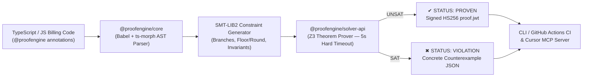

# ProofEngine

[](https://github.com/DaveSuri/proofengine/actions/workflows/proofengine-ci.yml)

**Deterministic Symbolic Execution & Z3 Theorem-Proving Layer for AI-Generated Financial, Billing, and Stripe Code.**

In enterprise engineering and indie SaaS alike, the biggest danger of AI-generated financial code isn't that it crashes—it's that it **runs successfully while silently leaking money**. **ProofEngine** extracts formal `@proofengine:invariant` and `@proofengine:boundary` annotations from TypeScript/JavaScript ASTs, compiles control-flow branches and arithmetic into **SMT-LIB2** constraints, and runs the **Z3 Theorem Prover** to either:
1. **`✔ PROVEN (UNSAT)`:** Mathematically prove the invariant holds across *all* possible inputs and issue a cryptographically signed HS256 attestation token (`proof.jwt`).
2. **`✖ VIOLATION (SAT)`:** Output the exact concrete counterexample inputs and cent-drift trace in milliseconds so the developer or AI coding agent (via MCP) can self-correct before merging.

---

## Architecture



### Monorepo Packages

| Package | Path | Description |
| :--- | :--- | :--- |
| **`@proofengine/core`** | [`packages/core`](./packages/core) | Babel + `ts-morph` AST parser, `@proofengine` DSL extractor, and SMT-LIB2 constraint generator (`if/else`, ternaries, `while` loops, `Math.floor`/`round`/`ceil`/`max`/`min`, idempotency `f(s, e)`). |
| **`@proofengine/solver-api`** | [`packages/solver-api`](./packages/solver-api) | Z3 solver integration (`z3-solver`), negated refutation runner, counterexample extractor, HS256 `proof.jwt` attestation signer, and persistent 10-call freemium workspace quota gate. |
| **`@proofengine/cli`** | [`packages/cli`](./packages/cli) | Developer CLI binary (`proofengine verify`, `proofengine check`, `proofengine quota`, `proofengine subscribe`). |
| **`@proofengine/mcp-server`** | [`packages/mcp-server`](./packages/mcp-server) | Model Context Protocol (MCP) server exposing `verify_financial_invariants`, `scan_financial_code`, `check_quota`, and `purchase_verification_subscription` to Cursor, Windsurf, and Claude. |

---

## Quickstart

### 1. Install & Build
```bash
git clone https://github.com/DaveSuri/proofengine.git
cd proofengine
npm install
npm run build
```

### 2. Run All Verification Test Suites
```bash
npm test
# Individual suites:
npm run test:core       # Milestone 1: AST extraction & SMT-LIB2 generation
npm run test:solver     # Milestone 2: Z3 UNSAT proof.jwt & SAT counterexample (<3s)
npm run test:mcp        # Milestones 4 & 5: MCP stdio server & HTTP 402 payment gate
npm run test:disasters  # All 5 Enterprise & Vibe-Coder disaster scenarios
```

### 3. Launch the Localhost Web Studio (with User Signup & API Keys)
```bash
npm start
# Opens http://localhost:4321
```

---

## Example: Catching a Subtle Stripe Proration Rounding Leak

### 1. The AI-Generated Bug
An AI coding agent writes a mid-cycle Stripe seat adjustment function that floors the prorated credit and used balance *per seat* before multiplying by `seats`:

```typescript
// @proofengine:boundary remaining_days in [1, 364]
// @proofengine:boundary seats in [2, 100]
// @proofengine:boundary annual_seat_price_cents == 120000
// @proofengine:boundary discount_rate == 0.175

export async function createMidCycleProrationAdjustment(
  remainingDays: number,
  seats: number,
  annualSeatPriceCents: number,
  discountRate: number,
) {
  const netSeatPriceCents = annualSeatPriceCents * (1 - discountRate);
  const expectedInvoiceAmount = Math.round(seats * netSeatPriceCents);

  // ⚠️ BUG: Per-seat floor rounding before multiplying by seats leaks fractional cents
  const perSeatUnusedCredit = Math.floor((remainingDays / 365) * netSeatPriceCents);
  const totalCredits = seats * perSeatUnusedCredit;

  const perSeatUsedBalance = Math.floor(((365 - remainingDays) / 365) * netSeatPriceCents);
  const balanceDue = seats * perSeatUsedBalance;

  const drift = (totalCredits + balanceDue) - expectedInvoiceAmount;

  // @proofengine:invariant total_credits + balance_due == expected_invoice_amount
  return { totalCredits, balanceDue, expectedInvoiceAmount, drift };
}
```

### 2. Z3 Catches the Exact Counterexample in 367ms
```bash
npx proofengine verify test/fixtures/proration.ts --no-quota
```
```text
   1. ✖ VIOLATION (SAT)  total_credits + balance_due == expected_invoice_amount
       vars:11 · constraints:14 · 367ms

     Counterexample JSON trace:
     {
       "inputs": { "remainingDays": 1, "seats": 4, "annualSeatPriceCents": 120000, "discountRate": 0.175 },
       "computed": {
         "netSeatPriceCents": 99000,
         "expectedInvoiceAmount": 396000,
         "perSeatUnusedCredit": 271,
         "totalCredits": 1084,
         "perSeatUsedBalance": 98728,
         "balanceDue": 394912,
         "drift": -4
       },
       "drift": -4
     }
```

### 3. The Mathematically Proven Fix (`src/billing/proration.ts`)
```typescript
const totalCredits = Math.round((remainingDays / 365) * expectedInvoiceAmount);
const balanceDue = expectedInvoiceAmount - totalCredits;
```
```bash
npx proofengine verify src/billing/proration.ts --no-quota
# ✔ PROVEN (UNSAT)  total_credits + balance_due == expected_invoice_amount (proof:eyJhbGciOiJIUzI1...)
```

---

## Real-World Disasters Prevented (`npm run test:disasters`)

| # | Scenario | Formal `@proofengine:invariant` | Buggy Counterexample Caught by Z3 | Fixed Status |
| :- | :--- | :--- | :--- | :--- |
| **1** | **Mid-Cycle Proration & 7-Seat Downgrade Leak** | `total_credits + balance_due == expected_invoice_amount` | `remainingDays: 244, seats: 7, discount: 0.175 -> drift: -7 cents` | `✔ PROVEN (UNSAT)` |
| **2** | **Stripe Webhook Non-Idempotency Double-Credit** | `f(state, event_id) == f(f(state, event_id), event_id)` | `stateAfterOnce: 0.25, stateAfterRetry: 0.5 -> drift: +0.25` | `✔ PROVEN (UNSAT)` |
| **3** | **Knight Capital-Style Runaway Loop Failure** | `next_balance < balance` inside `while (balance > 0)` | `balance: 0.5, debt: 0 -> next_balance: 0.5` | `✔ PROVEN (UNSAT)` |
| **4** | **Negative Balance / "Infinite Coupon" Exploit** | `final_charge >= 0` | `basePrice: 2900, referralCredit: 2901 -> finalPrice: -1` | `✔ PROVEN (UNSAT)` |
| **5** | **US State & EU VAT Sales Tax Fallback Trap** | `tax_rate > 0 when destination_in_taxable_nexus == 1` | `destinationInTaxableNexus: 1, isCalifornia: 0 -> taxRate: 0` | `✔ PROVEN (UNSAT)` |

---

## Cursor / Claude MCP Integration

Add `.cursor/mcp.json` to your workspace:
```json
{
  "mcpServers": {
    "proofengine": {
      "command": "node",
      "args": ["./packages/mcp-server/dist/index.js"]
    }
  }
}
```
Paired with [`.cursor/rules/proofengine.mdc`](./.cursor/rules/proofengine.mdc), AI coding agents automatically instrument billing code with `@proofengine:invariant` annotations, invoke `verify_financial_invariants`, self-heal any Z3 counterexample drift, and surface the HTTP 402 approval prompt when the 10-verification free quota is reached.
