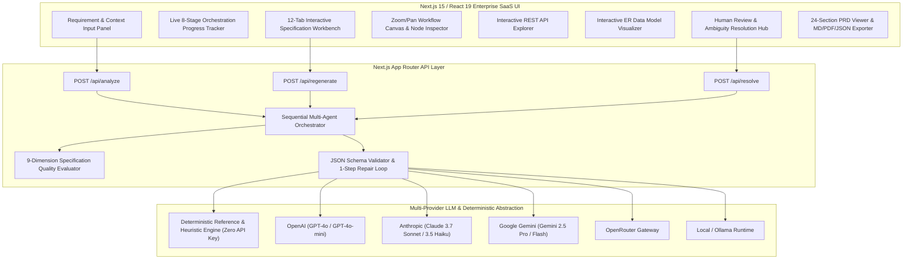

# AI Technical BA Agent

> **Turn a messy business idea into a build-ready technical specification in minutes.**

**AI Technical BA Agent** is an enterprise B2B Technical Business Analysis and Product Requirements Document (PRD) orchestration platform. It takes an ambiguous plain-English business requirement, executes a sequential **8-agent analysis pipeline** with strict JSON schema contracts, surfaces hidden ambiguities for human sign-off, maps state-machine workflows, specifies REST APIs and normalized data models, generates Given/When/Then acceptance criteria, performs a hostile QA & AI security audit, and compiles a **24-section engineering-ready PRD**.

---

## 1. What the Application Does

Most software delivery failures originate in requirements ambiguity—not coding syntax. When stakeholders say *"We need an AI chatbot that qualifies leads and books appointments"*, engineering teams face dozens of unstated questions around qualification scoring rules, calendar OAuth scopes, double-booking race conditions, timezone normalization, prompt injection, and PII compliance.

**AI Technical BA Agent** solves this by:
- Decomposing raw business requests across **8 specialized AI/deterministic analysis stages**.
- Separating **User-provided information**, **AI inferences**, and **AI recommendations** with explicit confidence indicators (`High`, `Medium`, `Low`).
- Providing a **Human-in-the-Loop Ambiguity Resolution Hub** where Product Managers or Technical BAs can resolve open questions and re-run only the affected downstream agents.
- Computing a transparent **Specification Quality Score (0–100)** across 9 engineering readiness dimensions.
- Exporting the final specification as **Markdown (.md)**, **PDF**, or **JSON**.

---

## 2. Architecture



---

## 3. Agent Architecture

Rather than relying on a single monolithic prompt, the system enforces a sequential **8-agent pipeline** where each agent has a bounded responsibility and strict JSON output contract:

| Stage | Agent Name | Role Title | Core Output |
| :--- | :--- | :--- | :--- |
| **1** | **Requirements Analyst** | Principal Business Systems Analyst | Problem, Users, Objectives, Actors, Capabilities, Explicit & Implied Requirements, Assumptions (with Confidence & Provenance tags) |
| **2** | **Ambiguity Detector** | Requirements Risk & Gap Auditor | Categorized Ambiguities (`Critical`/`High`/`Medium`/`Low`), Engineering Impact, Clarifying Questions, Downstream Stage Graph |
| **3** | **Workflow Mapper** | Process & State Machine Architect | Trigger, State Nodes, Decision Branches, Failure Recovery States, Human Handoffs, Mermaid Flowchart |
| **4** | **Technical Analyst** | Staff Solutions Architect | Frontend, Backend, Services, Auth/Authz, Business Logic, Notifications, Background Jobs, AI Components, Infrastructure (`Required` vs `Recommended` vs `Future / Optional`) |
| **5** | **API / Data Dependency Analyst** | Data & Integration Architect | REST Endpoints (`Method`, `Path`, `Auth`, `Request/Response JSON`, `Failure Codes`), Normalized Entities (`Fields`, `Types`, `Validation`, `PII Flags`), Mermaid ER Diagram |
| **6** | **Acceptance Criteria Generator** | Lead Product Owner & BDD Specialist | Prioritized User Stories (`P0`, `P1`, `P2`, `Out of Scope` with reasoning) & `Given / When / Then` Acceptance Criteria |
| **7** | **QA / Edge Case Reviewer** | Principal QA & AI Security Reviewer | Hostile-constructive QA matrix (Race conditions, Duplicate requests, AI hallucination, Prompt injection, PII leaks, Timeouts) |
| **8** | **Final PRD Generator** | Senior Technical Product Manager | Consolidated **24-Section PRD**, MVP vs Phase 2 Matrix, Implementation Sequence, and **9-Dimension Specification Quality Score** |

---

## 4. Data Flow

1. **Intake**: The user enters a plain-English business requirement and optional context (`Business/Product`, `Target Users`, `Existing Systems`, `Constraints`, `Timeline`, `Budget`) and selects an execution mode (`Fast`, `Balanced`, `High Quality`).
2. **Sequential Pipeline Execution**:
   - Stage $N$ receives the original request + structured JSON outputs from Stages $1 \dots N-1$.
   - Each stage's JSON output is validated against required schema keys before advancing.
3. **Evaluation & Synthesis**:
   - Stage 8 compiles all 7 upstream outputs into the 24-section PRD and invokes `evaluateSpecificationQuality()` (`src/lib/qualityScore.ts`).
4. **Interactive Human-in-the-Loop Refinement**:
   - **Ambiguity Resolution**: Resolving an ambiguity in the **Open Questions** tab promotes that business rule to `User-provided information` (`High` confidence), re-runs downstream stages, updates Acceptance Criteria and the 24-section PRD, and recalculates the Specification Quality Score.
   - **Isolated Section Regeneration**: Clicking **Regenerate** on any tab re-runs only that stage (with optional custom guidance) and updates the final PRD without losing upstream context.

---

## 5. AI Orchestration & Guardrails

- **No Blind Trust**: Every generated requirement, capability, user story, and assumption is tagged with:
  - **Source Provenance**: `User-provided information` | `AI inference` | `AI recommendation`
  - **Confidence**: `High` | `Medium` | `Low`
- **JSON Output Reliability**: `executeStructuredAgentCall()` (`src/lib/providers/llmProvider.ts`) strips markdown fences, parses JSON, verifies required top-level schema keys, and automatically executes a **1-step repair prompt retry** if an LLM returns malformed JSON.
- **Cost & Latency Tiering**:
  - `Fast`: Uses lightweight models (`gpt-4o-mini`, `claude-3-5-haiku-latest`, `gemini-2.5-flash`) across all stages.
  - `Balanced`: Uses fast models for classification/extraction stages and flagship models (`gpt-4o`, `claude-3-7-sonnet-latest`, `gemini-2.5-pro`) for technical architecture and final PRD synthesis.
  - `High Quality`: Uses flagship models across all 8 stages.

---

## 6. API Architecture

The Next.js App Router backend exposes three stateless JSON endpoints:

| Method | Endpoint | Purpose |
| :--- | :--- | :--- |
| `POST` | `/api/analyze` | Executes the full 8-stage orchestration pipeline for a business request and optional context. |
| `POST` | `/api/regenerate` | Regenerates a single `stageId` with optional `customInstruction` while preserving upstream context. |
| `POST` | `/api/resolve` | Applies stakeholder answers to one or more `AmbiguityItem` IDs, re-runs downstream stages, and updates the PRD & Quality Score. |

---

## 7. Setup Instructions

### Prerequisites
- **Node.js** `>= 18.18.0` (tested on Node `v22.x`)
- **npm** or **pnpm**

### Installation & Local Development

```bash
cd ai-technical-ba-agent
npm install
npm run dev
```

Open [http://localhost:3000](http://localhost:3000) in your browser.

### Running Automated Verification Tests

```bash
cd ai-technical-ba-agent
npm test
```

### Production Build

```bash
cd ai-technical-ba-agent
npm run build
npm start
```

---

## 8. Environment Variables

Copy `.env.example` to `.env.local`:

```bash
cp .env.example .env.local
```

```env
# Optional — Demo Mode works with zero API keys configured
OPENAI_API_KEY=
ANTHROPIC_API_KEY=
GEMINI_API_KEY=
OPENROUTER_API_KEY=
OLLAMA_BASE_URL=http://localhost:11434
```

You can also enter an API key or switch providers at runtime using the **Settings** drawer in the top navigation bar.

---

## 9. Demo Mode

**Demo Mode works out of the box without any paid API subscription.**
- Clicking **Try Demo** in the header or input panel immediately executes the full 8-stage pipeline for `"We need an AI chatbot that qualifies leads and books appointments."`
- In addition, the deterministic engine (`src/lib/demo/dynamicDemoSynthesizer.ts`) supports the other built-in templates (*Invoice OCR Extraction*, *Slack Employee Leave*, *Home Cleaning Marketplace*) as well as any custom plain-English business requirement.

---

## 10. How to Add Another Agent

1. Add the new stage identifier to `AgentStageId` and `PIPELINE_STAGES` in `src/lib/types.ts`.
2. Define the TypeScript output interface in `src/lib/types.ts`.
3. Add the system prompt and `requiredKeys` array to `AGENT_PROMPTS` in `src/lib/agents/orchestrator.ts`.
4. Wire the stage call into `runFullOrchestrationPipeline()` and `generatePrdMarkdown()`.

---

## 11. How to Add Another LLM Provider

1. Add the provider slug to `LLMProviderType` in `src/lib/types.ts`.
2. Add model selection logic in `selectModelForStage()` and API key resolution in `resolveProviderApiKey()` inside `src/lib/providers/llmProvider.ts`.
3. Implement the HTTP fetch adapter inside `rawProviderCompletion()` in `src/lib/providers/llmProvider.ts`.

---

## 12. Security Considerations

- **API Key Isolation**: Environment variables are read strictly on the server side inside Next.js API routes; server keys are never serialized to client bundles.
- **No Unvalidated AI Claims**: The UI enforces a persistent governance banner reminding stakeholders that AI-generated specifications require human review before implementation.
- **Prompt Injection & Schema Enforcement**: All LLM responses are constrained to JSON objects and validated against required schema keys before state updates.

---

## 13. Known Limitations

- **Client-Side Project Persistence**: Saved analyses in `Recent Analyses` are persisted in browser `localStorage` (up to 12 recent analyses) rather than an external cloud database so the app runs self-contained with zero infrastructure setup.
- **PDF Export**: Uses native browser print-to-PDF media queries (`window.print()`) for zero-dependency vector PDF generation.

---

**Built by Devansh Suri**  
*AI Product Management · Technical Business Analysis · Agentic AI*
